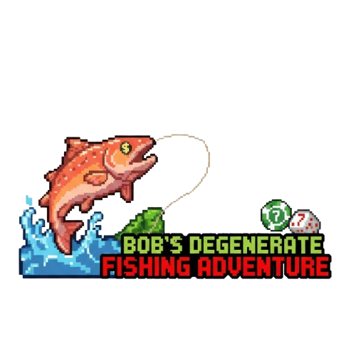
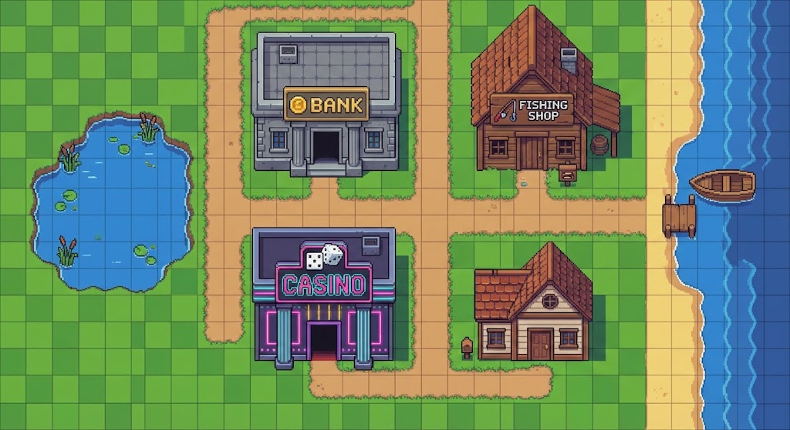

<p align="center">
  
</p>

<h1 align="center">Bob's Degenerate Fishing Adventure</h1>

<p align="center">
  Een pixel-art vis- en gokspel in Python en pygame.<br>
  Vis, verkoop je vangst en betaal je schuld af, of vergok alles in het casino.
</p>

<p align="center">
  
</p>

---

## Het verhaal

Twee jaar geleden verloor Bob alles door zijn gokverslaving: zijn spaargeld en zijn familie. Hij heeft nu een schuld van **$2.500**.

Om zijn leven weer op te bouwen gaat Bob terug naar zijn oude passie: vissen. Hij verkoopt zijn vangst bij de lokale handelaar om zo langzaam zijn schuld af te betalen.

Alleen is er net een glimmend nieuw **casino** in de stad geopend...

## Hoe werkt het spel?

Je begint met **$500** en **1 hengel**. Je doel: de $2.500 schuld bij de bank afbetalen in zo weinig mogelijk dagen.

| Locatie | Wat kun je er doen? |
| --- | --- |
| 🎣 **Vijver** | Vis lokaal: Bass, Salmon en Catfish. Hier kun je altijd vissen. |
| 🌊 **Zee** | Vis op zee: Tuna, Lobster en de waardevolle Seahorse. Hiervoor heb je een boot en een vergunning nodig. |
| 🏪 **Visshop** | Verkoop je vis en koop een boot ($500), een zeevergunning ($100) of extra hengels (maximaal 10). |
| 🎰 **Casino** | **Double or Nothing**: 50% kans om je inzet te verdubbelen. **Lucky 7**: 1 op 7 kans op 6x je inzet. |
| 🏦 **Bank** | Betaal je schuld af zodra je genoeg geld hebt. Daarmee eindigt het spel. |

**Vissen:** elke hengel heeft per visbeurt 50% kans op een vangst. De waarde van een vis hangt af van de soort, het gewicht en de zeldzaamheid (Common, Uncommon, Rare of Legendary). Meer hengels betekent meer vis per beurt.

**Dagen:** elke visbeurt en elke gok kost een dag.

**Score:** `1000 − (dagen × 10) + het geld dat je overhoudt`. De beste scores komen in de highscorelijst. Aan het eind krijg je een rang, van *Bankrupt Fisherman* tot *Legend of the Seas*.

## Besturing

| Toets | Actie |
| --- | --- |
| `W` `A` `S` `D` / pijltjestoetsen | Lopen |
| `E` | Vissen of praten met de balie (shop, casino, bank) |
| Lopen over een deur | Gebouw in- of uitgaan |
| `Enter` | Inzet of naam bevestigen |
| `Esc` | Pauzemenu, of een balie verlaten |

## Installeren en spelen

Je hebt **Python 3.10 of nieuwer** nodig.

```bash
git clone https://github.com/Fedde-Pons/Bobs-Degenerate-Fishing-Adventure.git
cd Bobs-Degenerate-Fishing-Adventure
pip install -r requirements.txt
python3 main.py
```

> **Let op:** het spel gebruikt [pygame-ce](https://pyga.me/), de Community Edition van pygame. De gewone `pygame` 2.6.1 crasht op Python 3.14. Heb je die al geïnstalleerd, verwijder hem dan eerst met `pip uninstall pygame`.

Het spel draait fullscreen op een schaal van 1920×1080.

## Projectstructuur

```
├── main.py            # Alle spellogica, schermen en game loop
├── highscores.json    # Opgeslagen highscores
├── img/               # Achtergronden, collision maps, knoppen en character sprites
└── muziek/            # Achtergrondmuziek en voetstapgeluiden
```

De gebouwen en muren werken met **collision maps**: aparte zwart-witafbeeldingen die bepalen waar Bob wel en niet kan lopen.

## Over dit project

Gemaakt door **Fedde Pons** en **Serhat** tijdens de Challenge Week van Basecamp, jaar 1, Hogeschool Rotterdam (december 2025).
